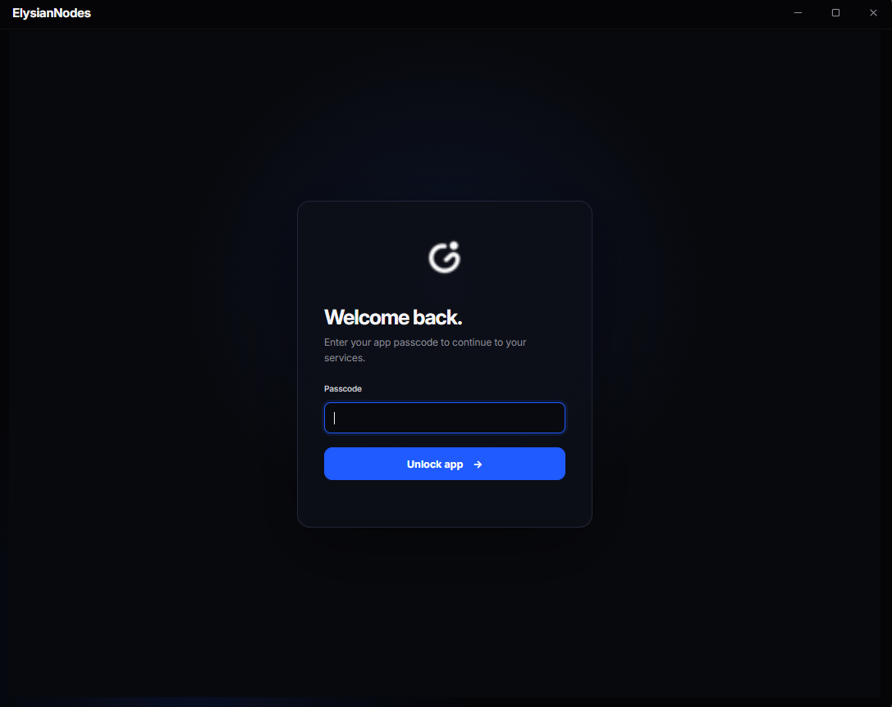
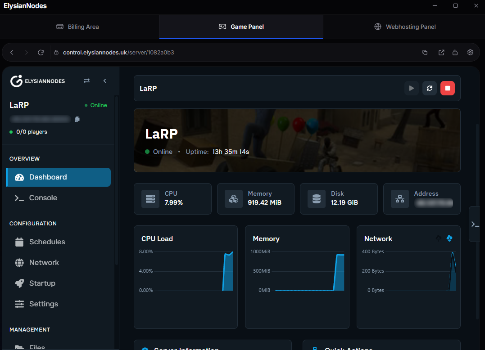

# ElysianNodes

ElysianNodes is a Windows desktop app that brings the ElysianNodes billing area, game panel, and webhosting panel together in one place. It is built with [Electron](https://www.electronjs.org/).

## Screenshots

| Sign in | Game panel |
| --- | --- |
|  |  |

## Features

- Access the billing area, game panel, and webhosting panel from separate tabs.
- Navigate each panel with familiar back, forward, reload, and address controls.
- Protect the app with an optional local passcode.
- Receive updates from published GitHub releases and install them from the app.
- Optionally connect Discord Rich Presence from settings.

## Install

Download the latest **ElysianNodes-Setup** installer from the [GitHub Releases](https://github.com/ElysianNodes/app/releases) page, run it, and follow the setup prompts. The app is currently packaged for Windows x64.

The first version with updater support must be installed manually. After that, the app can check for and install updates offered by published releases.

## Run from source

### Requirements

- Node.js 22 or later and npm
- Windows for building the installer

Install dependencies and launch the app:

```powershell
npm install
npm start
```

For development mode, which opens the developer tools:

```powershell
npm run dev
```

## Build

Create an unpacked application:

```powershell
npm run pack
```

Build the Windows installer:

```powershell
npm run dist
```

Build output is written to `dist/`.

## Publishing a release

The GitHub Actions workflow builds and publishes a Windows installer when a version tag is pushed. To publish a release:

1. Set the version in `package.json` and commit the matching `package-lock.json`.
2. Create and push a matching tag, for example `v1.0.3` for version `1.0.3`.
3. The workflow builds the installer and publishes it with the updater metadata to [GitHub Releases](https://github.com/ElysianNodes/app/releases).

The tag must match the package version exactly, including the leading `v`.

## Local authentication data

The optional app passcode is stored as a salted scrypt hash encrypted with the operating system's secure storage. Packaged Windows builds also encrypt Chromium cookies using Windows-provided cryptography. Other website data, including local storage, is not encrypted by these protections. The passcode is a screen lock and does not replace your Windows account password or protect the profile from software running as the same Windows user.

## License

ElysianNodes is licensed under the GNU General Public License v3.0 only. See [LICENSE](LICENSE) for the full license text.
