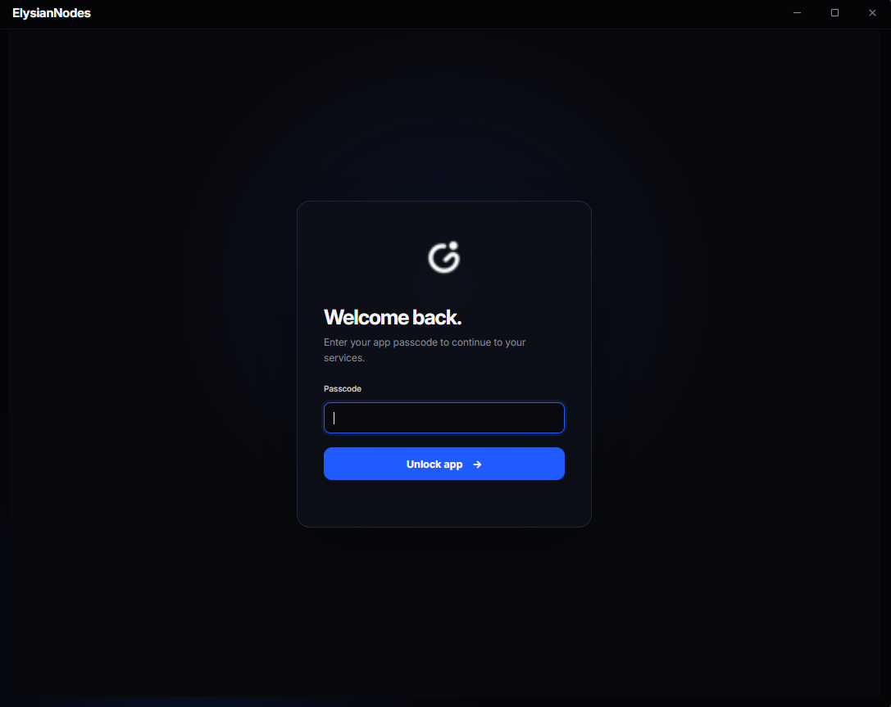
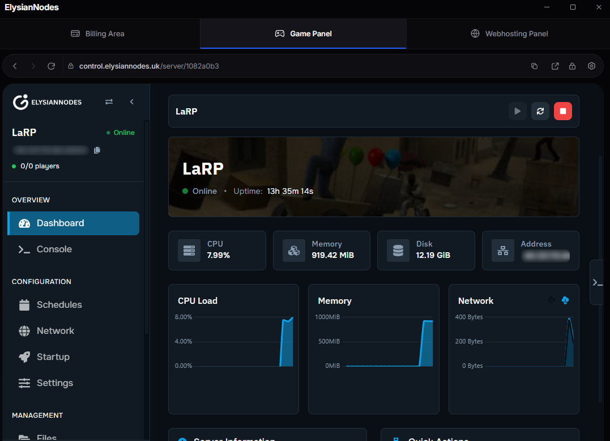

# ElysianNodes

ElysianNodes is a Windows and Linux desktop app that brings the ElysianNodes billing area, game panel, and webhosting panel together in one place. It is built with [Electron](https://www.electronjs.org/).

## Screenshots

| Sign in | Game panel |
| --- | --- |
|  |  |

## Features

- Access the billing area, game panel, and webhosting panel from separate tabs.
- Navigate each panel with familiar back, forward, reload, and address controls.
- Protect the app with an optional local passcode.
- Receive updates from published GitHub releases and install them from the app.
- Optionally connect Discord Rich Presence from settings.

## Install

Download the latest release from the [GitHub Releases](https://github.com/ElysianNodes/app/releases) page:

- **Windows x64:** run the **ElysianNodes-Setup** installer and follow the setup prompts.
- **Linux x64:** download `ElysianNodes-<version>.AppImage`, make it executable with `chmod +x ElysianNodes-<version>.AppImage`, and run it. Some distributions need `libfuse2` installed for AppImages to start.

The first version with updater support must be installed manually. After that, the installed app can check for and install updates offered by published releases.

## Run from source

### Requirements

- Node.js 22 or later and npm
- Windows to build the installer, or Linux to build the AppImage

Install dependencies and launch the app:

```powershell
npm install
npm start
```

For development mode, which opens the developer tools:

```powershell
npm run dev
```

## Build

Create an unpacked application:

```powershell
npm run pack
```

Build the Windows installer:

```powershell
npm run dist
```

Build the Linux AppImage:

```bash
npm run dist:linux
```

Build output is written to `dist/`.

## Publishing a release

The GitHub Actions workflow builds and publishes a Windows installer and a Linux AppImage when a version tag is pushed. To publish a release:

1. Set the version in `package.json` and commit the matching `package-lock.json`.
2. Create and push a matching tag, for example `v1.0.3` for version `1.0.3`.
3. The workflow builds both packages and publishes them with the updater metadata to [GitHub Releases](https://github.com/ElysianNodes/app/releases).

The tag must match the package version exactly, including the leading `v`.

## Local authentication data

The optional app passcode is stored as a salted scrypt hash encrypted with the operating system's secure storage. On Linux, this requires a desktop keyring. Packaged Windows builds also encrypt Chromium cookies using Windows-provided cryptography. Other website data, including local storage, is not encrypted by these protections. The passcode is a screen lock and does not replace your account password or protect the profile from software running as the same user.

## License

ElysianNodes is licensed under the GNU General Public License v3.0 only. See [LICENSE](LICENSE) for the full license text.
